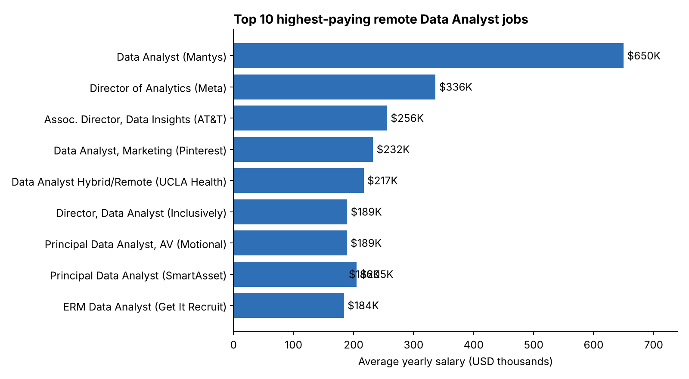
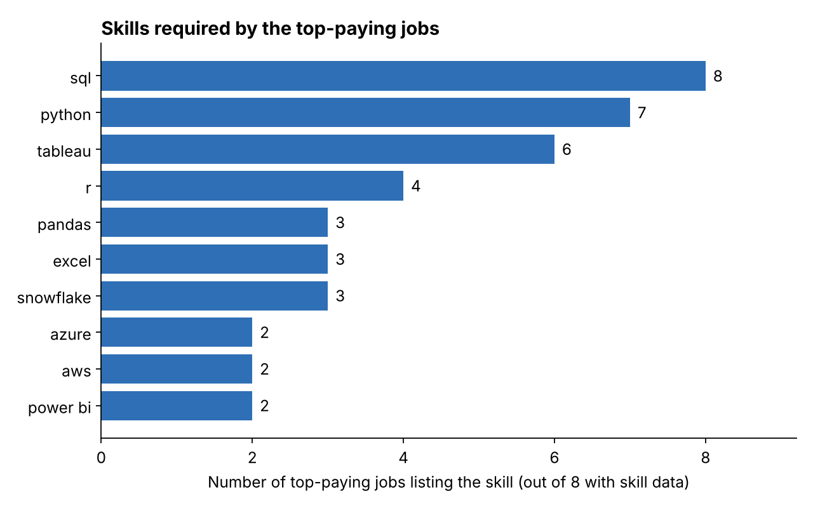
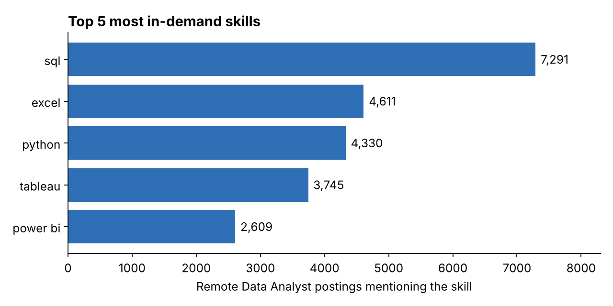
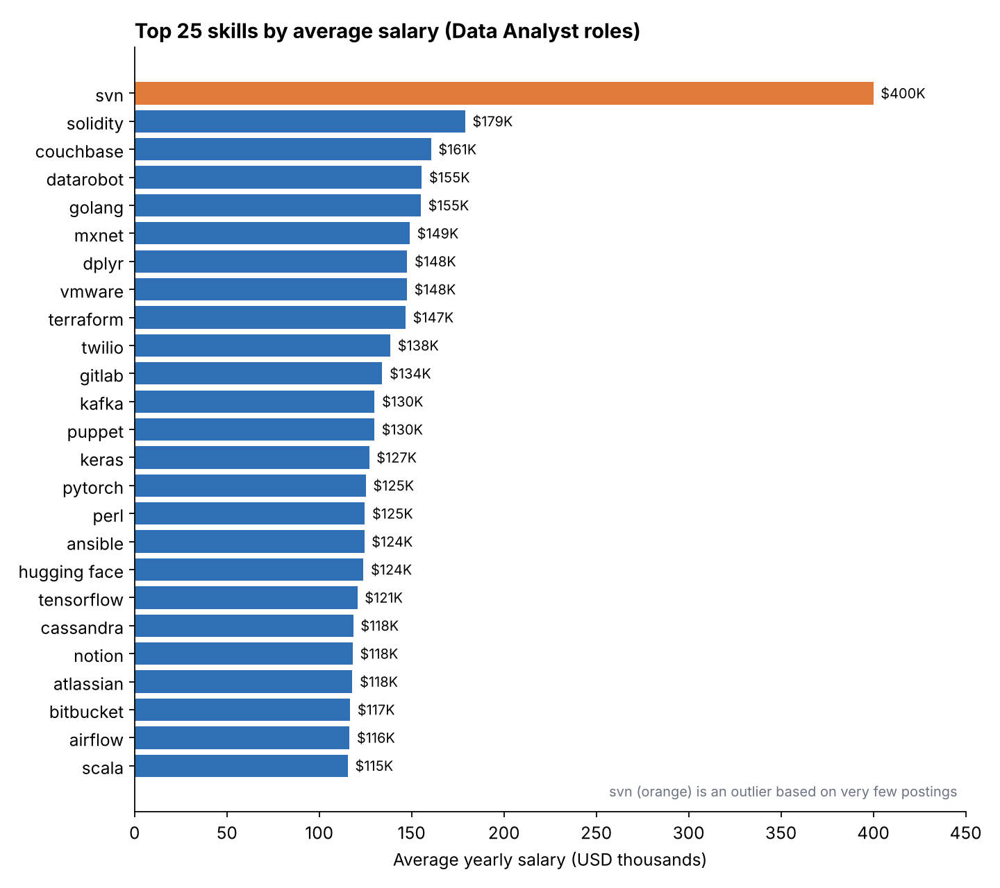
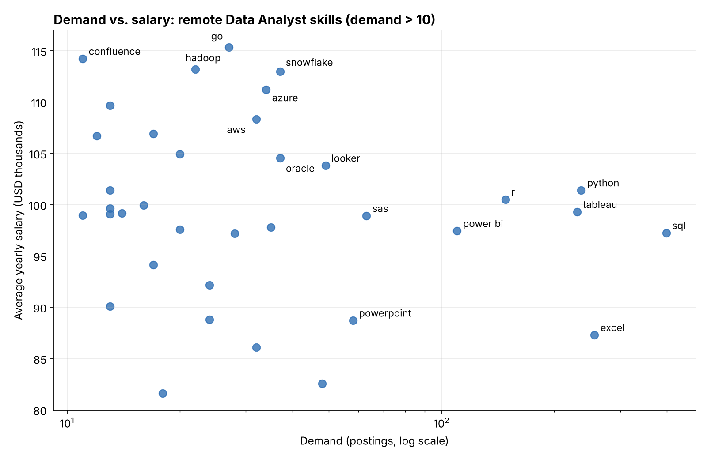

# Data Analyst Job Market Analysis with SQL

## Introduction

Which Data Analyst jobs pay the most, which skills do employers ask for, and which skills are worth learning first?

This project answers those questions by running SQL queries on a job postings database. It looks at **remote** Data Analyst roles and links pay, skills and demand, so a job seeker can decide what to learn.

SQL queries are in the [`project_sql`](./project_sql/) folder.

## Background

I wanted to understand the Data Analyst job market and find the best skills to learn, in the sense of **high demand and high salary**.

The data comes from a job postings dataset with four tables:

| Table | What it holds |
|---|---|
| `job_postings_fact` | One row per job posting: title, location, salary, remote flag, posted date |
| `company_dim` | Company names, linked by `company_id` |
| `skills_dim` | Skill names, linked by `skill_id` |
| `skills_job_dim` | Link table between jobs and skills (many-to-many) |

### The five questions

1. What are the top-paying Data Analyst jobs?
2. What skills do those top-paying jobs require?
3. What are the most in-demand skills for Data Analysts?
4. Which skills are linked to higher salaries?
5. What are the most optimal skills to learn (high demand **and** high salary)?

## Tools I Used

- **SQL**: the main tool for all analysis (joins, CTEs, aggregates, filtering)
- **PostgreSQL**: the database system
- **Visual Studio Code**: for writing and running queries
- **Git and GitHub**: version control and sharing the project
- **Python (matplotlib)**: to draw the charts from the query results

## The Analysis

Each query file contains its question, the SQL, and the result as JSON.

### 1. Top-paying Data Analyst jobs

I took the 10 highest-paying remote Data Analyst postings that have a listed salary, and joined `company_dim` to get the company name.

```sql
SELECT
    job_id,
    job_title,
    job_location,
    job_schedule_type,
    salary_year_avg,
    job_posted_date,
    name AS company_name
FROM
    job_postings_fact
LEFT JOIN company_dim ON job_postings_fact.company_id = company_dim.company_id
WHERE
    job_title_short = 'Data Analyst' AND
    job_location = 'Anywhere' AND
    salary_year_avg IS NOT NULL
ORDER BY
    salary_year_avg DESC
LIMIT 10;
```



*Bar chart of the 10 highest average yearly salaries for remote Data Analyst postings.*

**What the results show**

- Salaries range from **$184,000 to $650,000** a year.
- The top posting (Mantys, $650,000) is far above the rest. The second is $336,500 (Meta). Treat the top figure as an outlier.
- Employers include Meta, AT&T, Pinterest and SmartAsset, so high pay is not limited to one type of company.
- Many top titles are senior (Director, Principal, Associate Director). Seniority is a large part of why these roles pay so much.

### 2. Skills required for the top-paying jobs

I used a CTE to hold the top 10 jobs from query 1, then joined it to `skills_job_dim` and `skills_dim` to list each job's skills.

```sql
WITH top_paying_jobs AS (
    SELECT
        job_id,
        company_dim.name,
        job_title,
        salary_year_avg
    FROM job_postings_fact
    LEFT JOIN company_dim ON company_dim.company_id = job_postings_fact.company_id
    WHERE job_location = 'Anywhere'
      AND job_title_short = 'Data Analyst'
      AND salary_year_avg IS NOT NULL
    ORDER BY salary_year_avg DESC
    LIMIT 10
)
SELECT
    top_paying_jobs.*,
    skills
FROM top_paying_jobs
INNER JOIN skills_job_dim ON top_paying_jobs.job_id = skills_job_dim.job_id
INNER JOIN skills_dim ON skills_job_dim.skill_id = skills_dim.skill_id
ORDER BY salary_year_avg DESC;
```



*Count of top-paying jobs that list each skill. Only 8 of the 10 jobs have skill data (the Mantys and Meta postings have none), so the maximum is 8.*

**What the results show**

- **SQL** appears in all 8 jobs and **Python** in 7.
- **Tableau** is next, in 6 jobs. **R** appears in 4.
- Cloud and engineering tools also show up: Snowflake, Azure, AWS, Pandas, GitLab, Jira and Bitbucket. Top roles often expect more than basic reporting skills.

### 3. Most in-demand skills

This query counts how many remote Data Analyst postings mention each skill and keeps the top 5.

```sql
SELECT
    skills,
    COUNT(skills_job_dim.job_id) AS demand_count
FROM job_postings_fact
INNER JOIN skills_job_dim ON job_postings_fact.job_id = skills_job_dim.job_id
INNER JOIN skills_dim ON skills_job_dim.skill_id = skills_dim.skill_id
WHERE
    job_title_short = 'Data Analyst'
    AND job_work_from_home = TRUE
GROUP BY
    skills
ORDER BY
    demand_count DESC
LIMIT 5;
```



*Number of remote Data Analyst postings mentioning each of the top 5 skills.*

| Skill | Postings |
|---|---|
| SQL | 7,291 |
| Excel | 4,611 |
| Python | 4,330 |
| Tableau | 3,745 |
| Power BI | 2,609 |

**What the results show**

- **SQL** is the clear leader, well ahead of every other skill.
- **Excel** is still the second most requested skill, so spreadsheet skills remain essential.
- **Python** is third, and two visualization tools (**Tableau** and **Power BI**) complete the top 5.

### 4. Top skills by average salary

This query averages `salary_year_avg` for each skill across Data Analyst postings that list a salary (any location) and shows the top 25.

```sql
SELECT
    skills,
    ROUND(AVG(salary_year_avg), 0) AS avg_salary
FROM job_postings_fact
INNER JOIN skills_job_dim ON job_postings_fact.job_id = skills_job_dim.job_id
INNER JOIN skills_dim ON skills_job_dim.skill_id = skills_dim.skill_id
WHERE
    job_title_short = 'Data Analyst'
    AND salary_year_avg IS NOT NULL
GROUP BY
    skills
ORDER BY
    avg_salary DESC
LIMIT 25;
```



*The 25 skills with the highest average salary. The orange bar (svn) is an outlier.*

**What the results show**

- **Version control and DevOps tools** (svn, gitlab, bitbucket, puppet, ansible, terraform) pay well.
- **Machine learning and AI libraries** (pytorch, tensorflow, keras, mxnet, hugging face, datarobot) are common in the top 25.
- **Big data and database tools** (kafka, cassandra, couchbase, airflow, scala) also rank high.
- `svn` at $400,000 is based on very few postings, so it should not be taken as typical. Averages for rare skills can be driven by a single job.

### 5. Optimal skills to learn

This query combines demand and salary. Two CTEs calculate the demand count and the average salary per skill for **remote** Data Analyst jobs with a listed salary, then join them. Skills with 10 or fewer postings are removed so the averages are more reliable.

```sql
WITH skills_demand AS (
    SELECT
        skills_job_dim.skill_id,
        skills_dim.skills,
        COUNT(skills_job_dim.job_id) AS demand_count
    FROM job_postings_fact
    INNER JOIN skills_job_dim ON job_postings_fact.job_id = skills_job_dim.job_id
    INNER JOIN skills_dim ON skills_job_dim.skill_id = skills_dim.skill_id
    WHERE job_postings_fact.job_title_short = 'Data Analyst'
      AND job_postings_fact.job_work_from_home = TRUE
      AND job_postings_fact.salary_year_avg IS NOT NULL
    GROUP BY skills_job_dim.skill_id, skills_dim.skills
),
average_salary AS (
    SELECT
        skills_job_dim.skill_id,
        ROUND(AVG(job_postings_fact.salary_year_avg), 0) AS avg_salary
    FROM job_postings_fact
    INNER JOIN skills_job_dim ON job_postings_fact.job_id = skills_job_dim.job_id
    WHERE job_postings_fact.job_title_short = 'Data Analyst'
      AND job_postings_fact.job_work_from_home = TRUE
      AND job_postings_fact.salary_year_avg IS NOT NULL
    GROUP BY skills_job_dim.skill_id
)
SELECT
    skills_demand.skill_id,
    skills_demand.skills,
    skills_demand.demand_count,
    average_salary.avg_salary
FROM skills_demand
INNER JOIN average_salary ON skills_demand.skill_id = average_salary.skill_id
WHERE demand_count > 10
ORDER BY average_salary.avg_salary DESC, skills_demand.demand_count DESC
LIMIT 50;
```



*Each dot is a skill. Right means more demand, higher means higher salary. The demand axis is on a log scale.*

| Skill | Demand | Avg salary |
|---|---|---|
| Go | 27 | $115,320 |
| Snowflake | 37 | $112,948 |
| Azure | 34 | $111,225 |
| AWS | 32 | $108,317 |
| Oracle | 37 | $104,534 |
| Looker | 49 | $103,795 |
| Python | 236 | $101,397 |
| R | 148 | $100,499 |
| Tableau | 230 | $99,288 |
| Power BI | 110 | $97,431 |
| SQL | 398 | $97,237 |
| Excel | 256 | $87,288 |

**What the results show**

- **Python, R and Tableau** combine high demand (148 to 236 postings) with above-$99,000 average pay.
- **SQL** has the highest demand (398) and a solid salary (about $97,000). It is the safest foundation.
- **Cloud and data platform skills** (Snowflake, Azure, AWS, Go, Hadoop) have lower demand but the highest salaries, so they are good skills to add next.
- **Excel** is in high demand (256) but has one of the lowest average salaries ($87,288) in this group. It is expected by employers but does not set a candidate apart on pay.

## What I Learned

- **Joins across a link table.** Connecting jobs to skills needs two joins through `skills_job_dim`. I learned how `INNER JOIN` and `LEFT JOIN` differ and when to use each.
- **GROUP BY and aggregates.** Every selected column must be grouped or aggregated. I practised `COUNT`, `AVG`, `SUM` and `ROUND`.
- **Filtering at the right stage.** `WHERE` filters rows before grouping, and `HAVING` filters groups after. NULL handling with `IS NOT NULL` was important for salary data.
- **CTEs and subqueries.** Breaking a problem into named steps made the longer queries (questions 2 and 5) readable.
- **Reading results critically.** Averages can mislead when the sample is small (`svn`, the $650,000 posting), so I added a minimum demand filter in the last query.
- **Debugging.** I fixed errors like missing aliases, wrong clause order and ambiguous column names.

## Conclusions

### Insights

1. **Top pay is high but uneven.** The top 10 remote Data Analyst jobs pay $184,000 to $650,000, and many are senior titles.
2. **SQL is the core skill.** It is the most demanded skill (7,291 postings) and appears in every top-paying job with skill data.
3. **Python and Tableau are the next best investments.** They rank in the top 5 for demand, appear often in the top-paying jobs and pay above average.
4. **Specialized skills pay more.** Cloud, big data and machine learning tools (Snowflake, Azure, AWS, Go, Hadoop, PyTorch, TensorFlow) have the highest average salaries.
5. **The best learning path is demand first, then specialization.** Build SQL, Excel, Python and a visualization tool, then add a cloud or data platform skill.


### Closing thoughts

This project improved my SQL skills and showed how a database can answer real career questions. The next step could be repeating the analysis for other roles, such as Data Scientist or Data Engineer, or adding a time dimension to see how skill demand changes through the year.

## Repository structure

```
.
├── README.md
├── images/
│   ├── 1_top_paying_jobs.png
│   ├── 2_top_paying_job_skills.png
│   ├── 3_top_demanded_skills.png
│   ├── 4_top_skills_by_salary.png
│   └── 5_optimal_skills.png
└── project_sql/
    ├── 1_top_paying_job.sql
    ├── 2_top_paying_job_skills.sql
    ├── 3_top_demanded_skills.sql
    ├── 4_top_skills_based_on_salary.sql
    └── 5_optimal_skill.sql
```